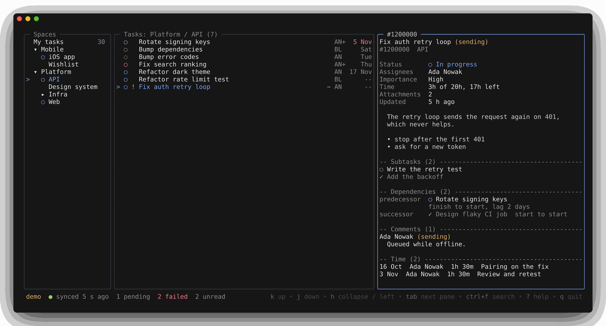
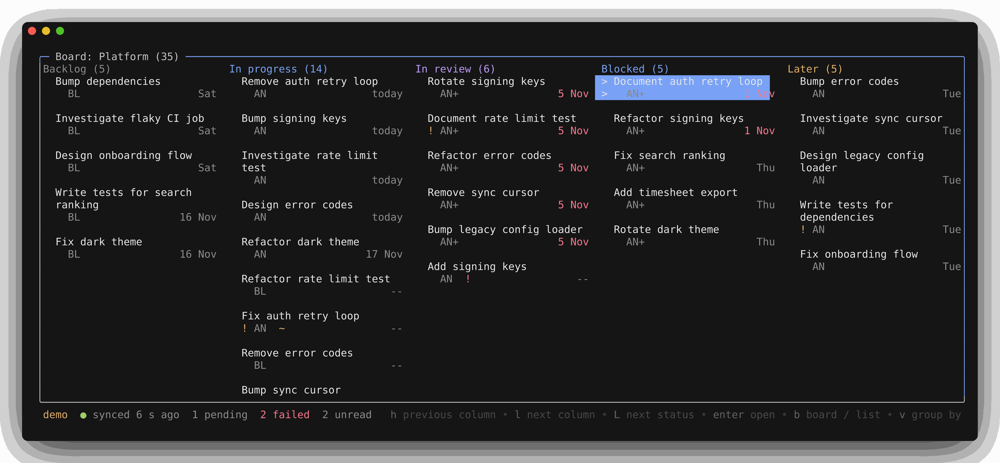
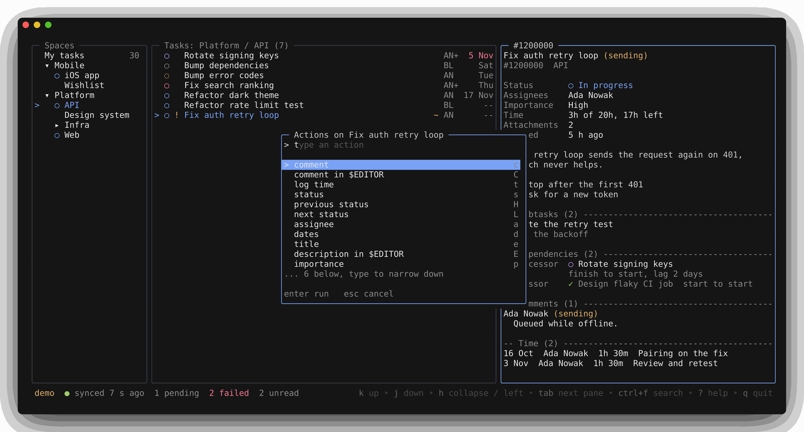
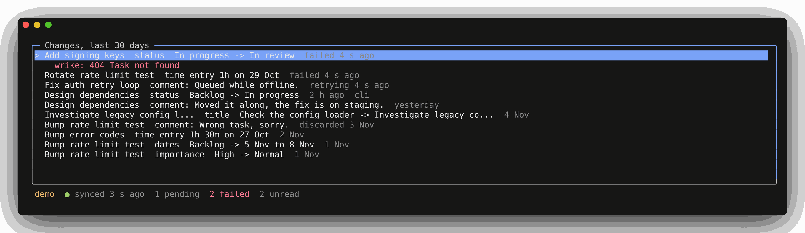
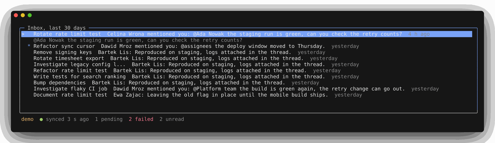
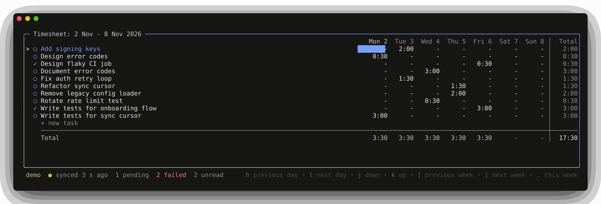
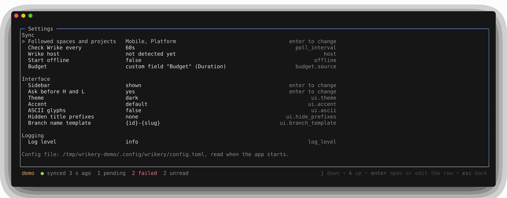

# Overview

Wrikery is a terminal client for Wrike, made for people who prefer the keyboard and the terminal over the web application.

Two goals drive every design decision:

1. Speed. Moving through the app feels instant, with no spinners, and the first screen is up almost at once after the start.
2. Working offline. Browsing works from a local copy of the data, with or without a network. Changes made offline wait in a queue and are sent when the connection is back.

- [What it does](#what-it-does)
- [Getting started](#getting-started)
- [The main screen](#the-main-screen)
- [Task list and board](#task-list-and-board)
- [Task detail](#task-detail)
- [Actions on a task](#actions-on-a-task)
- [Search](#search)
- [Changes](#changes)
- [Inbox](#inbox)
- [Timesheet](#timesheet)
- [Settings](#settings)
- [Offline mode](#offline-mode)
- [Moving to another data center](#moving-to-another-data-center)
- [Config](#config)
- [Commands](#commands)

## What it does

Reading:

- browse the spaces, projects and folders you follow, and change that set from the settings screen
- task list and task detail: description, status, assignee, dates, comments, subtasks, dependencies and the number of attachments
- instant full text search over everything cached
- open any task by its link or id, followed or not
- a board over workflow statuses, plain or with a lane per person or per folder
- narrow the list and the board to importance levels, a person and statuses, in any combination
- a timesheet view of your own logged time, and a time budget against the logged time in the task detail
- an inbox of the comments that mention you or land on tasks you follow
- a changes screen with what went out over the last thirty days and the writes that failed

Writing:

- create a task
- add comments
- change the title, description, status, importance, assignee, dates, folders and budget of a task
- log, edit and delete your own time entries
- offline, every write waits in a queue and goes out when Wrike is reachable again

From a shell, for scripts and agents:

- list tasks, show one, create one, change its status, title, importance, description, people and folders, comment on it, and read back the changes made through Wrikery, as text or JSON
- drive the interface that is running: set its filter, show a task, open a folder, switch the shape or the screen, refresh
- run one sync cycle
- an agent skill that teaches a coding agent the commands, and a source word that tells its writes from yours

Not in scope: creating subtasks and dependencies, editing custom fields other than the one the budget lives in, dashboards, Gantt charts.
The tool does not try to replace the web application for heavy project management.

## Getting started

### First run

1. Paste a Wrike API token.
   The app checks it and stores it in the system keychain.
   The data center is detected from the token, or picked on the same screen from the three Wrike hosts, once, at the sign in.
2. Pick the spaces and projects to follow from a checklist.
   The choice can be changed later from the settings screen.
3. Watch the first sync run.

The goal is less than a minute from install to a working app.

When the config names an API app registered in Wrike, the first step offers a sign in through the browser instead, with the token one key away:

- The browser opens Wrike's sign in page, the user allows the app, and Wrike sends the browser back to a local port the app listens on.
- The address can also be opened by hand, and the one the browser lands on pasted into the box, for a terminal on another machine.
- A browser sign in gives an access token that lives an hour, the app renews it on its own, in the interface and in the commands.

`wrikery --logout` signs out, whichever way the sign in happened, and the next start asks again.

### Demo mode

`wrikery --demo` runs on built in sample data, no token and no network, to try the interface.
The demo has one custom field, a Duration called Budget, with a value on a few tasks, and uses it as the budget source when the config names none, so the time line and the budget row show without a config file.
`WRIKERY_DEMO_TASKS=60000` in the environment adds that many generated tasks in a third space, to see the interface at the size of a large account, seeded on every start, so the start takes some seconds.
`WRIKERY_DEMO_COMMENTS=15` next to it gives each of those tasks fifteen comments over three years and a few of them long discussions, a million comments take about a minute to seed.

## The main screen

Three panes: a sidebar with the followed spaces and projects, a task list and a detail pane for the selected task.
A status bar at the bottom shows the sync state, an offline indicator and the number of pending or failed writes.
When Wrike rejects a request the bar says the sync is failing instead of offline, since the network is fine and the log has the reason.
Started with `--offline`, the bar says offline mode instead, nothing is pulled or sent, and `R` goes online, see [Offline mode](#offline-mode).

### Width

A wide terminal shows all three panes, a medium one shows two, and a terminal narrower than eighty columns shows one, so the app stays usable in a small tmux split.
The visible panes always include the one in focus, so moving focus can slide the window forward or back by one pane.
`S` hides the sidebar once you know your way around the tree: the list and the detail take its width, tab cycles between the two, and the selected folder stays selected.
`S` again brings it back with the focus on it, and the bottom bar names the key while the pane is away.
`ctrl+b` does the same, except inside tmux, which takes that key as its prefix and never passes it on.
The choice is kept across restarts, like the pinned view, and the settings screen shows it.

### Names and glyphs

A name wider than the sidebar is cut in the middle, so its start and its end stay readable, and the list pane title shows the full path.
An emoji built from several parts, a family for example, is drawn as its parts, because terminals do not agree on how wide the joined form is and a wrong width breaks the frame.
A skin tone and the frame of a keycap are left out for the same reason, so a hand is drawn without its tone and a keycap as its digit.

### Keys

Vim style keys (j, k, h, l, g, G) and arrow keys both work, and `?` shows a help overlay with every binding for the current screen.
The keys of the screens and the boxes are in their sections, these work on the main screen:

| key | action |
| --- | --- |
| `tab` `shift+tab` | next and previous pane |
| `enter` `esc` | one level deeper, back |
| `j` `k` `g` `G` | move, first and last row |
| `ctrl+d` `ctrl+u` | half of the rows on screen down and up in the sidebar, the list and the task detail, page down and page up do the same |
| `/` | filter the current list as you type |
| `S` or `ctrl+b` | hide the sidebar or bring it back, `ctrl+b` not inside tmux |
| `ctrl+f` | search over everything cached |
| `.` | every action on the selected task, with its key |
| `v` `b` | the grouping of the list, the board |
| `f` `F` | the filter box, clear the filter |
| `z` | show completed and cancelled tasks in the list |
| `n` | new task |
| `!` `@` `T` `,` | the changes screen, the inbox, the timesheet, the settings screen |
| `R` | refresh from Wrike right away instead of waiting for the next poll, or go online after a confirm when the app was started offline |
| `?` | every key for the current screen |
| `q` | quit |

### The sidebar

In the sidebar `/` filters the tree by name and shows the matches with the folders above them, Enter keeps the filter and Esc clears it with the match still selected.
Space in the sidebar pins the space, project or folder under the cursor, and `P` shows only the pinned ones, with their parents and whatever is open under them.
The pins and the toggle are kept across restarts.

A jump to a task, from the search, the changes screen, the inbox or the timesheet, opens the way to its folder through a collapsed parent, the tree filter or the pinned view.
When none of its folders is in the sidebar, your own task lands in My tasks, and any other task stays in the detail pane over the list that was on screen until you go back to that list.
A jump to a completed task, from the search, the changes screen or the timesheet, turns `z` on for the folder it lands in and off again when the list moves to another folder.

A sync never moves the sidebar off the folder you are in while the folder is in the sidebar, a parent the new tree would leave collapsed is opened again.
When the folder is gone from the sidebar, deleted or hidden by the pinned view or the tree filter after the change, the cursor goes to the nearest parent still there and the list shows that one.
The task in the detail pane stays and the keys act on it, and from the list the pane takes the focus when the new list does not hold the task.
The status bar says which folder left.

## Task list and board

### Grouping

The task list can be grouped, and the same tasks can be shown as a board.
`v` cycles the grouping: none, by folder, by assignee, by status.

- By folder groups the tasks of a space or project by the folder or project one level below it, so a project reads by its epics, and one sidebar step down regroups by that epic's own children.
  On My tasks the group is the followed space or project the task sits in.
- By assignee puts you first and unassigned tasks last, a task with several people shows under each of them, and the assignee column shows the status name instead.

Each group starts with a line that carries its name and count, `{` and `}` jump between groups.

### Moving a task along its workflow

`H` and `L` move the selected task to the previous or next status of its workflow without opening the status box.
The first press asks you to confirm the move, with the task and both statuses named, and once you say yes the keys move at once from then on.
The settings screen shows that answer and can bring the question back.

### The filter box

`f` opens the filter box, which narrows the list and the board to what is ticked there: importance levels, one person and statuses.

- Within a section any ticked row matches, across sections a task has to match them all, and a section with nothing ticked takes every task.
- A task with several people counts for the person ticked, and ticking a person unticks the one before.
- The people offered are you, whoever is on a task in view and Unassigned, the statuses are those of the workflows the tasks in view use.
- The line under the rows says what is shown, and `F` clears the filter.
- A ticked status set also decides the board's columns, so unticking a status hides its column.
- The set and `z` keep each other in step: ticking a completed or cancelled status turns `z` on, and with a set in place `z` adds the done statuses of the workflows in view to it or takes them out.
- A status is picked by its name, so a set made on one folder holds on a folder whose workflow spells the same statuses with its own ids.
- A jump to a task the filter would hide clears the filter, the way it clears the `/` query, and a task just created lands on its row the same way.
- An edit that takes a task out of the filter lets it leave the list like any other.
- The filter stays while you move between folders and is not kept across restarts.

### The board

`b` turns the list into a board: a column per status of the workflow the tasks use, cards in the columns, and a lane per group when a grouping is on.
So the board by assignee is a standup, who is on what and what is stuck, and the board by folder is a board per epic.
Tasks on another workflow than most of the folder gather in one column named after that workflow, and `H` and `L` refuse to move them, the status box still works.

The board takes the width of the window, the sidebar and the task detail show while they have focus: `shift+tab` brings the sidebar, `enter` on a card opens the task on the right, `esc` gives the board the width back, and `esc` on the board itself returns to the list.
A hidden sidebar stays out of the board's cycle too, `shift+tab` from the board then goes to the detail, and `S` brings the sidebar back.
`h` and `l` move between columns, `j` and `k` between cards, `/`, `f`, `z` and every task key work as in the list.

An empty column is only as wide as its name.
When the columns do not fit, every column gives up width evenly, a card column down to 16 characters and an empty one down to a short name with its count, `Canc.. (0)`, so a workflow of ten statuses fits a wide terminal whole.
When even that is not enough, the columns that do not fit slide in as the cursor moves towards them.

### Cards and titles

A card shows the title on one line, or on two when it is long, and the break prefers a `: ` or ` - ` in the second half of the first line, so `(MX) Backend: Kafka - Processing` reads as a heading and a detail.
A blank line separates the cards of a column.
A code in parentheses at the start of a title, `(MX)`, is drawn muted and a short part prefix closed by `: ` or ` - `, `Backend: Kafka - `, slightly muted, on cards and rows alike, so the eye lands on the words that differ between tasks.
A High task carries a `!` next to its status glyph in the list and on its card, the other two levels show nothing there.

## Task detail

The pane on the right of the main screen shows the selected task, from the top:

- the title, with `(sending)` next to it while a write on the task is still queued and `(failed, ! to review)` when one failed
- the status, the assignees, the dates, the importance when it is not Normal, the time, the task this one is a subtask of and the number of attached files
- the description
- when the task has them, a list of its subtasks and a list of its dependencies
- the comment thread and the time entries

An action changes the local view at once and is sent to Wrike in the background.

### The description

The description comes from Wrike as HTML, it is converted to markdown and rendered in the terminal.
Underlined and struck text keep their look and a checklist shows its boxes, colors are not shown.
A link shows its text and then its address, or the address alone when the text is the address, as it is for a pasted one.

### The time line

The time line is the logged time against the task's budget, `12h 30m of 20h, 7h 30m left`, and `2h over` in the error color when the budget is spent.
A task with a budget and no entries reads `0h of 20h, 20h left`, a task with entries and no budget shows the logged time alone, and a task with neither has no line.
The logged time counts every person's entries on the task, the queued ones included.
Where the budget lives is a setting, see `[budget]` under [Config](#config), and on an account whose plan has no custom fields or no Effort field the line shows the logged time only.

### Attachments

Attachments are counted only, their names and the files stay in the web application, `o` opens the task there.

### Subtasks and dependencies

A subtask line starts with the status glyph in its color, a done one is muted.
A dependency line names the other task and whether it is a predecessor, a task this one comes after, or a successor, one it comes before, followed by the relation type as Wrike words it, finish to start and the like, and the lag in work days or hours, written as a lead when the successor may start early.
A related task that lives in a space you do not follow is fetched on its own at the next sync when the task you look at is one you follow, and until then, or when Wrike does not share it with you, the line says so instead of a title.
The related tasks of a task that was itself fetched this way are not fetched in turn, their lines stay as they are.

### Comments and time entries

A task whose comments and time entries were never synced says `not synced yet` under both, the read runs when the cursor rests on the task for a second or you open it with enter, and the lines go when it lands.
New comments and time entries on any cached task arrive with the next sync whether or not you opened the task, and the inbox lists the comments addressed to you.

## Actions on a task

Every action on the selected task sits on a single key, and `.` lists them all with their keys, narrowed as you type, enter runs the highlighted one and esc closes the list.

| key | action |
| --- | --- |
| `c` | comment |
| `C` | comment in an editor |
| `t` | log time |
| `s` | status |
| `H` `L` | previous and next status, see [Moving a task along its workflow](#moving-a-task-along-its-workflow) |
| `a` | assignee |
| `d` | dates |
| `e` | title |
| `E` | description in an editor |
| `p` | importance |
| `m` | folders |
| `o` | open the task in the browser |
| `y` `Y` `i` | copy its permalink, a branch name built from the task, the task id |
| none | budget, a row of the list without a key of its own |

`n` creates a task and is not tied to the selected one, see [New task](#new-task).

### Comment

`c` opens a small text box, ctrl+s or ctrl+d sends the comment and closes the box, esc cancels.
`C` hands the terminal to `$VISUAL` or `$EDITOR` on a temporary file instead, for a longer comment.
Saving and quitting the editor sends the file as the comment, an empty file sends nothing.
An editor that opens the file in a window of its own and returns at once, as the `code` and `cursor` commands do, gets a box instead: write and save there, then enter in wrikery sends the file and esc drops it.
If you would rather have the edit end when you close the tab, set `$VISUAL` to `code --wait` or `cursor --wait`, then wrikery waits for the window the way it waits for a terminal editor.

### Status

`s` lists the statuses of the task's workflow, grouped the way Wrike groups them.
Moving the cursor and pressing enter applies the highlighted status.
When the cache does not know the task's workflow yet, the box says so instead of offering another workflow, because a status from another workflow would move the task onto it.

### Assignee

`a` lists the contacts, narrowed as you type a name.
Space toggles a contact on or off, enter applies the change, esc cancels without one.

### Dates

`d` shows a start and a due field.
Both take quick words instead of a full date:

| typed | read as |
| --- | --- |
| an ISO date | that day |
| `today`, `tomorrow`, `yesterday` or `yday` | that day |
| a weekday, `fri`, `friday` or `thurs` | the coming one, never today |
| `last fri`, `next fri` | the previous Friday, the coming one |
| `+Nd`, `-Nd` | a day up to ten years away |
| a day and month, `12 sep` | that day, next year once it has passed |

The day a field reads to is shown next to it, so a wrong reading is visible before it is saved.
An empty field clears that date.
Tab moves between the two fields, enter saves, esc cancels.
Saving lets Wrike recompute the duration from the new dates, a custom duration set elsewhere is not kept.

### Log time

`t` opens a box with hours, date and note fields.
Hours take `1.5`, `1,5`, `1:30`, `90m`, `2h`, `2h30m` or `1h 20m`, the form logged time is shown in.
The date takes the same quick words as the dates box and defaults to today, with one difference: time is logged after the fact, so a weekday or a day and month is the latest one and today counts, `mon` on a Thursday is three days back, `fri` on a Friday is today and `28 dec` in January is last year.
The note is optional.
Ctrl+p in the note field takes the note of an earlier entry on the task, own entries first and newest first, and ctrl+n goes back towards what was typed.
Tab moves between the fields, enter saves, esc cancels.
Editing an entry cannot clear a note that is already there.

### Title

`e` opens a box with the title, enter saves, esc cancels.
An empty title is refused in the box, an unchanged one closes it without a write.

### Description

`E` opens the description in `$VISUAL` or `$EDITOR` as markdown, the way `C` does for a comment.
Wrike stores HTML, so the file is a translation, and only the paragraphs you change are translated back.
A paragraph you leave alone keeps the HTML it had, byte for byte, together with whatever markdown cannot say.

- Headings, bold, italics, code, links, lists, code blocks and strike-through (`~~text~~`) are plain markdown, and a checklist is a task list, `- [ ]` and `- [x]`.
- Underline and colored text have no markdown, they stay in the file as the tags Wrike uses, `<u>text</u>` and `text`, and new ones can be typed the same way.
- Images, tables and anything else the editor cannot express stay as HTML too.
- A newline is a line break and a blank line starts a new paragraph, also inside a code block, because Wrike keeps no raw newlines.

Saving an unchanged or an empty file writes nothing.

### Importance

`p` picks the importance, High, Normal or Low.

### Folders

`m` lists the followed spaces, projects and folders as a checklist with the task's folders checked, narrowed as you type.
The pinned folders come first, under a Pinned header, and the whole tree follows under All, so a pinned folder is a keystroke away instead of a few typed letters.
Each pinned row names its parent at the right edge, so two pinned folders with one name are told apart.
Space toggles a folder and enter applies the toggles, so a task can join or leave several folders in one go.
Enter with nothing toggled moves the task instead: it leaves the folders under the node in view and joins the highlighted one.
On My tasks no folder is in view, so the move only joins, and the same happens when the task sits in no folder under the node in view, after a search that found it elsewhere for example.
The first line of the box says which of the two enter will do.
Unchecking the last folder is refused: Wrike would put the task into the account root, which no followed scope covers, and the task would drop out of the cache at the next sync.
A folder outside the followed scopes is not in the list, the box counts it and never touches it.

### Budget

`budget` is a row of the `.` list without a key of its own.
It opens a box with one field for the budget, which takes the forms a time entry takes, `20h`, `1h 30m` or `0.5`, without the 24 hour limit, and an empty field clears the budget.
Enter saves, enter on the value the box opened with closes it without a write, esc cancels.
When the budget cannot be edited, the row says why instead of opening the box: no budget source is set, the account has no Effort field, or the custom field the config names is missing, of another type, or not in the task's space.

### New task

`n` creates a task, from any pane of the main screen.
The box asks for a title and shows the folder the task goes into, preset to the folder or project in view, or to the folder of the section under the cursor when the list is grouped by folder.
Tab moves to the folder field, which narrows the followed tree as you type, enter picks and goes back to the title, and enter on the title creates.
The folder field lists the pinned folders first, as the folders box does, so with no folder in view tab and enter take the first pinned one.
On My tasks no folder is in view, so the box asks for one, and the task is assigned to you so it stays in the view.
Elsewhere nobody is assigned.
`a`, `d`, `p` and `E` fill in the rest.
The task shows at once with `(sending)` next to its title and is sent to Wrike in the background.
Every key works on it right away and the writes wait in the queue until the create has landed, except `o`, `y`, `Y` and `i`, which say the task is not on Wrike yet.
A create that Wrike rejects shows on the changes screen, and discarding it removes the task together with everything queued on it.

## Search

ctrl+f opens a quick search over everything cached, backed by the full text index.
Type a few letters and the best matches show up at once, ranked, and enter jumps to the task.
A link to a task, the number from that link or a task id finds the task even when it is not cached: the box shows a last row that fetches it from Wrike, and enter on that row opens the task once it arrives.
The title hits stay above the row, a number can be part of a title.
A task the followed spaces do not cover lands the way a jump does, in My tasks when it is yours and over the list that was on screen otherwise, and it stays cached for thirty days after you last opened it.

## Changes

`!` opens the changes screen: the writes made through Wrikery over the last thirty days, newest first, each with the task, the field and the old and the new value.

| write | row |
| --- | --- |
| a status move | `status  In Progress -> Done` |
| a date change | `dates  Backlog -> due 15 Oct` |
| an assignee change | `assignee  + Ada Nowak  - Bartek Lis` |
| a comment or a new task | its first words |
| a time entry | its hours and day |

The row under the cursor shows the values in full on a second line, a long title or the first line of the old and the new description.
A write made by a command carries a `cli` tag, or the word the command found in `WRIKERY_SOURCE`, an agent's own name, so a change an agent made is told from one made here.
The same list prints from the command line with `wrikery changes`.

The writes still queued or failed sit at the top, marked `queued`, `sending`, `retrying` or `failed` with the error Wrike returned on the second line, so one that fails the same way every time can be discarded instead of holding the later writes on its task.
A task edit whose field someone changed on Wrike since it was queued is held there as failed, the second line names the field with its value on Wrike, and the old value on the row is now Wrike's, so the row reads what sending it would do.
`r` retries the highlighted queued row, a retrying one at once, `x` asks for confirmation and then discards it, and a discarded row stays in the list marked so.
On a held edit `r` sends it anyway and `x` drops it.
In offline mode `r` does nothing, there is nothing to send with yet, `x` discards as always, and a write a send failed on in an earlier session reads `queued`.
Enter opens the task, `g`, `G`, ctrl+d and ctrl+u move through the list, esc goes back to the previous screen.

The list is this machine's: it holds what this copy of Wrikery sent, not what other people or another computer changed on Wrike.
Discarding a task update does not roll back the change already applied to the local cache, the next refresh brings back whatever Wrike has.

## Inbox

`@` opens the inbox: the comments other people wrote in the last thirty days on the tasks you follow in Wrike, and the comments that mention you, newest first.
A row shows the task, the author and the comment on one line with the time at the end, `Fix auth retry loop  Ada Nowak: the staging run is green...  2 h ago`.
A comment that mentions you, by name, through a user group you belong to or through `@assignees` on a task you are assigned to, reads `Ada Nowak mentioned you: ` instead.
The row under the cursor shows the comment in full below it, up to three lines.
Enter opens the task the way the changes screen does, `g`, `G`, ctrl+d and ctrl+u move through the list, esc goes back.

A row you have not looked at yet starts with `*`, and the status bar counts those rows, `2 unread`, so a new comment is noticed without opening the screen.
Leaving the screen, with esc, by opening a task or by quitting, marks the rows that were on screen as seen, and a row that reaches the cache later is unread whatever its date, an older comment of a task that was just assigned to you for example.
That marker is this machine's: Wrike's own inbox is not read and reading there does not clear it, nor the other way round.

On a fresh cache the inbox starts with the first week of comments and older ones come in as their threads are read.
A mention of you on a task outside the spaces you follow is fetched on its own and stays cached for thirty days, like a task opened by its link.
What the inbox cannot show:

- a comment on a task you follow that lives outside the spaces you follow, when it does not mention you
- a mention of a group that contains your group rather than you
- your own comments

## Timesheet

A separate view (key T) shows the current week as a grid: tasks as rows, Monday to Sunday as columns.
A cell is the time logged on that task on that day as hours and minutes, `1:20`, or a dash when there is nothing.
Everywhere else logged time reads as `1h 20m`, `45m` or `2h`: the time section of a task, the message after logging, the entry lists and the changes screen.
Each row carries a total for the task, each column a total for the day, and the grid ends with a total for the week.
Rules set the totals apart from the entries, a vertical one before the task totals and one above the day totals.
The last row, `+ new task`, is for logging time on a task that has no row yet.

| key | action |
| --- | --- |
| `h` `l` | move between days |
| `j` `k` | move between rows |
| `[` `]` | one week back, one week forward |
| `.` | back to the current week |
| `n` | log time on the row's task for the selected day, on the `+ new task` row the quick search picks the task first, then the time entry box opens |
| `e` | edit the entry under the cursor, a small list asks which one first when the cell holds more than one |
| `x` | delete an entry after a confirmation, again through that list when the cell holds several |
| `enter` | open the task in the detail pane beside the grid |

The row under the cursor carries the cursor mark in front of its title, so on a wide grid a cell can be traced back to its task.
Next to the mark each row shows the status glyph of its task, the one the list draws.
A task outside the followed spaces is fetched on its own at the next sync, a row still without it shows the task id instead of a title and no glyph, and enter on that row asks Wrike for the task right away.

The sync engine keeps the current week and the eight weeks before it.
An older week shows a not synced line instead of entries, so it does not read like a week with nothing logged.
A cell with a write still queued shows the pending marker in front of the hours.
An entry that sits in a locked or approved timesheet is shown dimmed.
Editing or deleting it is refused with a message instead, nothing is queued for it.

Enter on a row opens the task in the detail pane beside the grid, from 120 columns, or over the grid on a narrower terminal.
The pane has the keys then: `j` and `k` scroll it, and the task keys work as on the main screen, `s` for the status, `c` for a comment, `t` to log time on the day under the cursor.
Tab hands the keys back to the grid with the pane still open, and the pane follows the row under the cursor, as it follows the list.
While the pane has the keys it stays on its task, a reload that drops its row from the grid does not move it.
Esc closes the pane and the cursor is on the cell it was on, a second esc leaves the timesheet.
Enter on the pane goes to the task on the main screen with its folder selected, the way the search does.

## Settings

`,` opens the settings screen, esc goes back.

| row | shows | enter |
| --- | --- | --- |
| Signed in with | a permanent token, or the browser with the app's client id, a row that is there once a sign in is stored | says that `wrikery --logout` signs out and the next start asks for a new sign in |
| Followed spaces and projects | the followed set | opens the Follow box |
| Check Wrike every, Start offline, Theme, Accent, ASCII glyphs, Hidden title prefixes, Branch name template, Log level | the value the config file sets, with the key it has in the file | edits the value in place |
| Wrike host | the data center, detected or picked, or the one the config file sets | says that the data center is set at the sign in, that `wrikery --logout` and a new sign in change it, or `host` in the config file, and names the file when the key is set |
| Budget | where the budget comes from as the cache sees it: not set, the Effort field, with a note when the account has none, or the custom field with its type, with a note when the field is missing or of a type that cannot hold hours | says to set `budget.source` in the config file and start the app again |
| Sidebar | whether the pane is shown or hidden | flips it, the same as `S` on the main screen |
| Ask before H and L | yes until a first `H` or `L` was confirmed, no from then on | flips it, so the question comes back or goes away |

### The Follow box

The Follow box lists the spaces and projects the first run offers, narrowed down by typing, the followed ones checked, space toggles a row, enter applies, esc cancels.
A followed project the list does not offer on its own, one moved deeper into a folder, keeps a row at the end so it can be unfollowed too.
Right after a cache reset the box says the spaces are still to come, and fills in when they arrive.
The first line of the box says what enter will do, for example that it follows one and unfollows two.
Your own tasks are always included and have no row.
Applying runs a full refresh: a newly followed scope is pulled from the start, and the tasks of an unfollowed scope leave the cache, unless they are your own.
The sidebar drops an unfollowed space at once and shows a newly followed one right away, its tasks arrive with the refresh.

### Editing a config value

Enter on a config row opens the value in place: a text field for the poll interval, the accent, the hidden prefixes and the branch template, a choice picked with left and right for the theme, the glyphs, the log level and `offline`.
Enter saves it to the config file, esc puts the old value back, and enter on a value left as it was writes nothing.
The hidden prefixes are typed separated by commas, a prefix may hold a space.
The file keeps its comments and its other lines, only the key's line is replaced, or added to its table.
A value the app would refuse at the next start, a poll interval below ten seconds for example, is refused on the screen with the reason and the file is not changed.
The theme, the accent, the glyphs, the hidden prefixes and the branch template apply at once, the poll interval reaches the sync engine and the next check follows it, the log level changes the log at once, and `offline` is read at the next start.
A theme set to auto takes the background the start detected, or keeps the current colors until the next start when the start had a fixed theme.
The demo edits nothing, its rows name the key and the file instead.

## Offline mode

`wrikery --offline` starts without syncing, for when you do not want to talk to Wrike yet.
Nothing is pulled and nothing is sent: the interface browses and searches the cache, a change is applied to it at once and waits in the queue, and a task the cache does not hold cannot be fetched.
The status bar says offline mode, and the detail of a task with a change waiting shows `(queued)` next to its title instead of `(sending)`.
The changes screen, `!`, is where the queue is reviewed, and a write you would rather not send can be discarded there with `x`.
`R` asks first, with the number of writes that go out, and the yes starts the sync the way a start without the flag does: the queue first, oldest first, then the pulls.
There is no way back to offline mode in the same session, start the app again with the flag.
`offline = true` in the config file makes every start offline, the interface and the commands alike, and `--offline=false` runs one start online anyway.
The first start needs Wrike for the sign in, so it refuses the flag.

## Moving to another data center

When Wrike moves an account to another data center, every API token stops working and the API answers on another host, `app-eu.wrike.com` for the EU data center.
wrikery remembers the account, the data center and the person its cache was built from, and a sign in to anything else sends nothing until you answer.
The steps, in the order they happen:

1. Before the move, put `offline = true` in the config file, so nothing syncs by accident, from the interface or from a command.
   Work as usual, the changes wait in the queue.
2. After the move, run `wrikery --logout`, then `wrikery --offline=false`, the first run needs Wrike.
3. Sign in with a new permanent token or through the browser.
   The data center can be picked on the sign in screen when the detection does not reach the new one.
   wrikery names the old and the new data center with the queued writes and asks whether this is the new home of the cache.
   `y` checks the queue against the new account, sends it there oldest first, and builds the cache again from the new account.
   A write whose task, folder or time entry the new account does not have, or whose task has a title the cache never knew, is held on the changes screen for `r` or `x`.
   `n` leaves everything as it is and says how to start a fresh cache instead.
4. Take `offline = true` out of the config file again.

If the config file names the old data center with `host = "www.wrike.com"`, change it or remove it before step 2, the sign in tries that host alone.
When the followed spaces and projects are not in the new account, the box that picks them opens after the first sync.
The same question comes when a sign in belongs to another account or another person than the cache, so changes made offline in one account never go to another without your yes.
A command never asks: with a token in `WRIKERY_TOKEN` of another account it refuses, exits with 1 and says to open wrikery.

## Config

The config file lives at `~/.config/wrikery/config.toml`, and `--config PATH` reads another file instead.
The settings screen edits most of these keys in place and keeps the rest of the file as it is, see [Settings](#settings).

| key | values | what it does |
| --- | --- | --- |
| `poll_interval` | a duration, ten seconds or more | how often the sync engine checks Wrike for changes |
| `log_level` | debug, info, warn or error | how much the app logs |
| `offline` | true or false | every start is offline, the interface and the commands alike, see [Offline mode](#offline-mode) |
| `host` | empty, `www.wrike.com`, `app-eu.wrike.com` or `app-us2.wrike.com` | empty, the default, means the app detects the Wrike data center at the sign in, or takes the one picked there, a host forces one instead and the sign in then checks that host alone |
| `[ui]` `theme` | auto, dark or light | the colors |
| `[ui]` `accent` | a color | the highlight color |
| `[ui]` `ascii` | true or false | replaces the drawing glyphs with plain characters on a terminal that cannot show them |
| `[ui]` `hide_prefixes` | a list of strings, `["(MX)"]` | title prefixes the rows and cards leave out, for a project code every task starts with, the detail pane keeps the full title and the branch name `Y` copies leaves the prefix out too |
| `[ui]` `branch_template` | default `{id}-{slug}` | the branch name that `Y` copies, `{id}` is the task's permalink number and `{slug}` its title lowercased and cut down to hyphen separated words |
| `[oauth]` `client_id`, `redirect_uri`, `client_secret` | the values of an API app registered in Wrike | the app for the browser sign in, `redirect_uri` is `http://localhost:8731/callback` unless the app was registered with another address, and `client_secret` is asked for at the first run when it is not in the file |
| `[budget]` `source` | `effort` or `field` | where a task's time budget lives, since Wrike has no single place for it, see below |
| `[budget]` `field` | a custom field's exact title or its id | the field read when the source is `field` |

Two flags belong with the file: `--no-color` gives plain output without colors, and so does `NO_COLOR` in the environment, and `--offline` starts one run without syncing.

The budget source:

- `source = "effort"` reads the Effort field of the task, the time budget of the task view and the Workload chart on the plans that have it.
  On an account whose plan has no Effort field the first read answers 403, the app leaves the field out from then on, says so once in the log, and a manual refresh asks again.
- `source = "field"` reads the custom field named by `field`: a Duration field holds the budget in minutes, a Numeric field in hours, and the field can belong to the account or to a space, in which case the task's own space decides which one is read.
- Without a source the detail shows the logged time alone and the budget row of the actions list says so.

## Commands

`wrikery` alone opens the interface, `wrikery <command>` runs one operation and exits.
The commands read the same local cache and queue writes through the same outbox as the interface.

| command | what it does |
| --- | --- |
| `sync` | sends the queue, refreshes the reference data and pulls the changes, `--full` also checks every followed scope for tasks deleted on Wrike, which is slower |
| `changes` | prints what the changes screen shows, the queue first and then the last thirty days, `--source` keeps the rows of one source and `--limit N` the first N rows |
| `task list` | the tasks of a folder, project or space with `--folder`, your own open tasks without, `--all` adds the completed and cancelled ones |
| `task show` | one task with its description and comments |
| `task status` | moves a task to a status of its workflow |
| `task create` | creates a task in a folder, with an importance and a description when given |
| `task edit` | changes the title, the importance or the description of a task in one write |
| `task comment` | adds a comment as you, in JSON the result carries the comment with its id |
| `task assign`, `task unassign` | put people on a task or take them off |
| `task move` | puts a task in folders with `--to` and takes it out of others with `--from`, in one write, `--to` alone adds a folder and keeps the rest, since a task can sit in several |
| `ui ...` | drive the interface that is running, see [The ui commands](#the-ui-commands) |
| `skill` | print or install the agent skill, see [The agent skill](#the-agent-skill) |
| `help` | the same page as `wrikery --help`, every command with its one line and the global flags, `help task` or `help ui` a group, `help <command>` one command with its flags, the text `<command> --help` prints |

`man wrikery` is the manual, with the commands, their flags and the keys of the interface, installed by the Homebrew cask and carried in the release archive.
Output is text for a person and `--json` for a script, and on a terminal the text is colored through the same theme as the interface, in a pipe it is plain.
A command's flags may come before or after its arguments, so `wrikery task status MAAAAAEPXpuT "In Progress" --json` and `wrikery task status --json MAAAAAEPXpuT "In Progress"` are the same.
A title with a word that starts with a dash goes after `--`, as in `wrikery task create --folder F -- --json is not a flag`, everything after `--` is title.

### Naming a task, a folder or a person

A task or a folder on the command line is an id or a part of its title that matches exactly one cached row, the match ignores case and accents as the search does, several matches are refused with the candidates listed.
When one of the matches has exactly the given title, ignoring case, that one is taken, and ignoring accents as well when none has it letter for letter.
A task can also be given as the number from its link in the browser or as the whole link, in quotes, both are looked up in the cached permalinks.
A bare number is only ever that number, it is never tried as a part of a title.
A link, a number or an id the cache does not hold is fetched from Wrike before the command goes on, reads and writes alike, which needs the sign in a write needs.
A person is `me`, a contact id or a part of a name that matches exactly one person in the cache, never a group.
For an unassign the people on the task are matched first, so someone who left the account can still be taken off.

### Reads

A read prints the cache and waits for the network only to fetch a task argument the cache lacks, or to read the comments and time entries of a task the cache never read, which `task show` does before it prints.
In offline mode it prints what the cache holds and marks such a thread `not synced yet`, in JSON as `thread_synced`.
A task in JSON has `pending` true while a write for it is waiting to be sent and `failed` true when Wrike rejected one.
`task show --json` has the description three ways: the plain text, the HTML Wrike stores and `description_markdown`, the text the editor opens on.
`wrikery changes` prints each row with the task, the field with its old and new value, the state and whether the interface or a command made it, so an agent can check what it did before it goes on.
In JSON the stored values stand next to the text, with ids where the text has names, `before` and `payload` as the outbox keeps them in Wrike's own field names, which can change between versions where the other keys do not.
On a terminal a line of `wrikery changes` is cut to the width.

### Writes

A write is queued and then sent at once, and the command reports the result: sent, queued when Wrike could not be reached within fifteen seconds or an earlier write on the same task is still being retried, rejected, or blocked when Wrike refused the token, which leaves the change queued and exits with 1.
A create already sent is waited for up to a minute and a half when Wrike rate limits.
A task edit someone changed on Wrike since it was queued is not sent, the command says which field changed and exits with 1, and the changes screen offers to send it anyway.
A queued write goes out with the next sync, from the interface or from `wrikery sync`.
In offline mode, `wrikery --offline` or `offline = true` in the config, a write is queued and not sent, the command says so and exits with 3, a task the cache does not hold is not fetched, and `sync` is refused.
The interface, when it is running at the same time, is told to re-read the cache by every write command and by `wrikery sync`, so their changes show at once.

A write a command made shows on the changes screen with a `cli` tag.
A command run with `WRIKERY_SOURCE` in its environment, a word of up to 24 letters, digits and hyphens, puts that word on the row instead, so an AI agent that sets its own name is told from the person's own commands, and a value that is not a word stops the command with exit 2.

A description is markdown, the text the `E` editor writes, from a file or from stdin with `-`.
An edit merges it with the description the cache holds, so a paragraph left as `description_markdown` prints it keeps the bytes Wrike stored, and an input that changes nothing sends nothing.
The write is the whole field, as from the editor, so a change made on Wrike between the show and the edit is overwritten by it.

A person already on the task, a folder it is already in, or a title, importance or status it already has is left out of the write with a note, and when nothing is left the command reports the task unchanged, `unchanged` true and `sent` false in JSON, and exits with 0.
Taking a task out of its last folder is refused, as in the folders box, and a move that leaves no followed folder on the task goes out with a note, since the task leaves the cache at the next sync.

| exit code | meaning |
| --- | --- |
| 0 | done, a write is on Wrike or changed nothing, a read printed the cache |
| 1 | an error, including a write Wrike rejected, a held edit and a token Wrike refused |
| 2 | bad usage, a `WRIKERY_SOURCE` that is not a word included |
| 3 | the write is queued but not on Wrike yet |

### The ui commands

The `ui` commands act on the interface that is running instead of the cache, through a socket next to the database, and print what it did.

| command | what it does |
| --- | --- |
| `ui filter` | narrows the list and the board the way the filter box does, with `--importance` and `--status` repeated for each level or status and one `--person`, and replaces the filter in place, `--clear` is `F` |
| `ui select T` | shows a task the way a pick from the search does |
| `ui folder F` | opens a space, project or folder the way enter on it in the sidebar does, `me` is My tasks |
| `ui list`, `ui board` | set the shape |
| `ui open tasks\|timesheet\|changes\|inbox\|settings` | opens a screen |
| `ui refresh` | is `R` |

A person is `me`, `unassigned`, a contact id or a part of a name, a status is checked against the cached workflows, and the interface's own line comes back, "showing High | Ada Nowak (me)" for a filter.
With no interface running the command says so and exits with 1, and a box, the search, the help, a filter field being typed in or the first run screen refuse the request the same way.
Two interfaces on one cache: the first keeps the socket, the second runs without it.
`wrikery --demo ui ...` drives a running demo, with every value as typed since the demo's cache is a throwaway, so a script can set up a screen without key presses.

### The agent skill

`wrikery skill` prints the skill that tells an AI agent how to work with Wrike through these commands, a short file in the Agent Skills format the coding agents read, https://agentskills.io: when to use the commands, how a task is named, the rules a script follows, what exit 3 and a rejected token mean, what the commands cannot do, with the JSON fields in a reference file next to it.
`wrikery skill install` writes the folder under `~/.claude/skills` and `~/.agents/skills`, the directories Claude Code and the other coding agents read, `--project` puts it under the working directory for one repository and `--dir` under one directory of choice, and it connects to nothing.
The same folder is in the repository under `skills/wrikery`, so `gh skill install mrcne/wrikery` and `npx skills add mrcne/wrikery` install it as well, pinned to a release tag.
